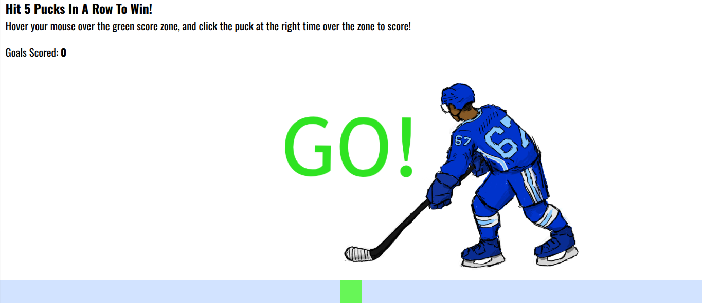

# HitThatPuck
My first attempt at a browser game. The goal is simple...get goals. 
Hover over the green strike zone and click the puck in time to score a goal. Get 5 goals in a row and you win the game for your team! If you miss one, well....

This was made for Wrong HackClub and was made STRICTLY with just HTML and CSS, no JS allowed! There's a lot more features I plan to add if I have the time, but I'm happy and quite proud with the progress I have. 

## Instructions
Want to play my game? Try it here: https://cooly-kirbyy.github.io/HitThatPuck/    
Want to restart before hitting all the pucks? Just refresh! 

Warning: I should have fixed the code so you can still get goals on different screen sizes (though, it won't always be aligned in the middle) but I don't think it works on mobile! 

